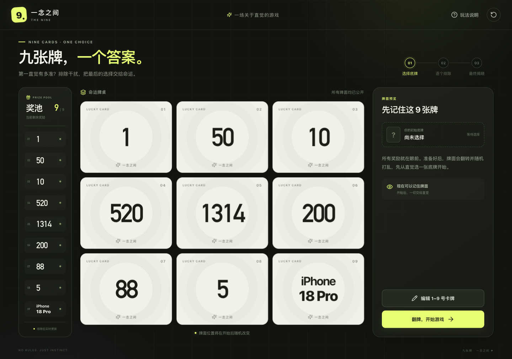

# 一念之间 · The Nine

[](https://github.com/echoCYQ/the-nine-game/actions/workflows/ci.yml)
[](LICENSE)
[](https://react.dev/)
[](https://vite.dev/)

一款完全在浏览器本地运行的九宫格直觉选择游戏。自定义九张卡牌，随机洗牌，逐张排除，在最后两张牌之间做出选择。



## 功能特性

- **完整游戏流程**：牌面预览、翻牌洗牌、锁定底牌、逐个排除、最终二选一。
- **自定义牌面**：1–9 号卡牌均支持数字、中文或英文，每张最多 10 个字符。
- **动态洗牌**：连续三轮真实位置交换动画，并支持 `prefers-reduced-motion`。
- **实时奖池**：排除后同步划线置灰，最终答案单独高亮。
- **响应式界面**：桌面三列布局，手机优先展示牌桌与操作，奖池支持横向滑动。
- **本地运行**：无账号、无后端、无数据上传。
- **类型安全与测试**：React + TypeScript，核心游戏规则由 Vitest 覆盖。

## 如何玩

1. 点击 **「翻牌，开始游戏」**，九张牌会翻面并随机打乱。
2. 凭直觉选择一张 **初始底牌**，底牌不可被排除。
3. 点击其他牌进行排除，每次揭晓后可 **开启初始底牌** 或 **继续排除**。
4. 只剩两张牌时，选择 **坚持初始底牌** 或 **选择最后一张**。
5. 所有牌面统一揭晓，点击 **「再玩一次」** 开始新牌局。

开局前可点击 **「编辑 1–9 号卡牌」** 自定义内容，牌桌和奖池会同步更新。

**[查看完整图文玩法与常见问题 →](docs/HOW_TO_PLAY.md)**

## 本地运行

环境要求：Node.js 20+，推荐使用 pnpm。

```bash
# 安装依赖
pnpm install

# 启动开发服务器
pnpm dev
```

打开终端显示的本地地址，默认是 `http://localhost:5173`。

也可以使用 npm：

```bash
npm install
npm run dev
```

## 构建与测试

```bash
pnpm build       # TypeScript 检查及生产构建
pnpm test        # 运行游戏规则测试
pnpm preview     # 预览生产构建
```

持续集成由 GitHub Actions 自动执行依赖安装、构建和测试。

## 项目结构

```text
src/
├── App.tsx          # 页面、交互动效与游戏状态
├── game.ts          # 卡牌数据、洗牌与规则函数
├── game.test.ts     # 核心规则测试
├── main.tsx         # React 入口
└── styles.css       # 桌面与移动端样式
docs/
└── HOW_TO_PLAY.md   # 完整玩法说明
.github/workflows/
└── ci.yml           # GitHub Actions CI
```

## 技术栈

- [React 19](https://react.dev/)
- [TypeScript](https://www.typescriptlang.org/)
- [Vite 6](https://vite.dev/)
- [Lucide React](https://lucide.dev/)
- [Vitest](https://vitest.dev/)

## 参与贡献

欢迎提交 Issue、功能建议或 Pull Request。开始前请阅读 [贡献指南](CONTRIBUTING.md)。

## 开源协议

本项目基于 [MIT License](LICENSE) 开源，可自由使用、修改和分发。
