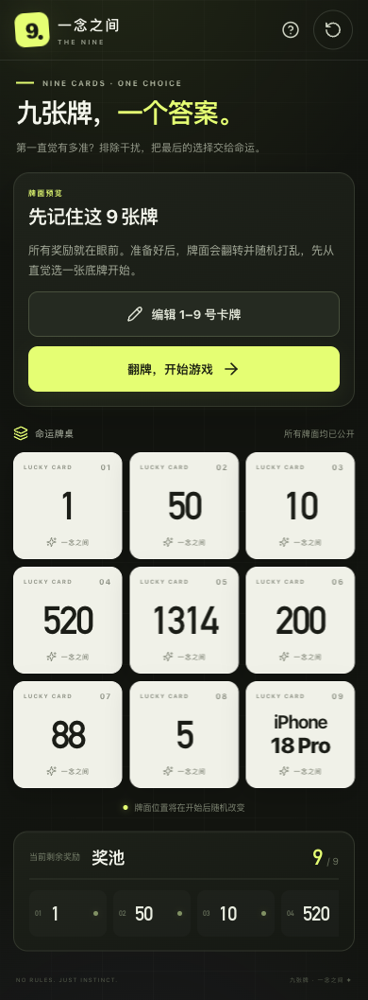

# 如何玩「一念之间」

九张牌，一个答案。这是一款关于第一直觉、排除与最终选择的小游戏，无需登录，也不需要联网服务。

## 一、自定义卡牌（可选）

1. 在开局预览界面点击 **「编辑 1–9 号卡牌」**。
2. 分别修改九张卡牌，支持数字、英文和中文，每张最多 **10 个字符**。
3. 点击 **「保存并应用」**，牌桌与左侧奖池会立即同步。
4. 如果想恢复初始内容，点击编辑器中的 **「恢复默认内容」**，再保存即可。

> 修改后的内容会在“再玩一次”和“重新开始”后保留；刷新浏览器会恢复默认牌面。游戏中途不能修改卡牌。

默认牌面为：`1、50、10、520、1314、200、88、5、iPhone18Pro`。

## 二、翻牌并随机打乱

点击 **「翻牌，开始游戏」**。九张牌会先翻到背面，再经过连续三轮位置交换动画完成随机洗牌。牌背数字只代表当前位置，不再代表初始卡牌编号。

## 三、选择初始底牌

凭第一直觉点击任意一张未知牌：

- 这张牌会成为你的 **初始底牌**。
- 底牌会显示锁定标识，在后续排除环节中不可被排除。
- 底牌内容在最终揭晓前保持隐藏。

## 四、逐张排除

1. 点击除底牌外的任意未知牌。
2. 该牌会立即翻开并标记为 **已排除**。
3. 左侧奖池中对应奖励会同步划线置灰，剩余数量减一。
4. 每次排除后，你都可以选择：
   - **开启初始底牌**：立即结束本局并揭晓结果；
   - **继续排除**：保留底牌，继续下一张。

## 五、最终二选一

排除七张牌后，桌上只剩初始底牌和最后一张未知牌。你可以：

- **坚持初始底牌**：相信第一直觉；
- **选择最后一张**：把答案交给命运。

做出选择后，所有牌面统一揭晓，最终答案与奖池对应项会高亮显示。点击 **「再玩一次」** 即可开始下一局。

## 手机端操作

- 游戏状态与操作按钮位于九宫格上方，牌桌优先显示。
- 奖池位于牌桌下方，可左右滑动查看全部奖励。
- 编辑器支持小屏双列或单列布局，所有按钮均可直接触控。
- 建议竖屏游玩；桌面、平板和手机浏览器均可使用。

## 常见问题

### 牌背上的 01–09 是卡牌编号吗？

不是，它们表示洗牌后的当前位置。每次开始游戏，位置都会重新随机排列。

### 为什么最后剩两张，而不是一张？

最后两张分别是你的初始底牌和未被排除的最后一张未知牌。你需要在两者之间做最终决定。

### 修改的牌面会永久保存吗？

当前版本只在本次页面会话中保留修改，刷新页面会恢复默认内容。

### 是否会上传我的数据？

不会。游戏完全在浏览器本地运行，没有账号、后端服务或数据上传。
